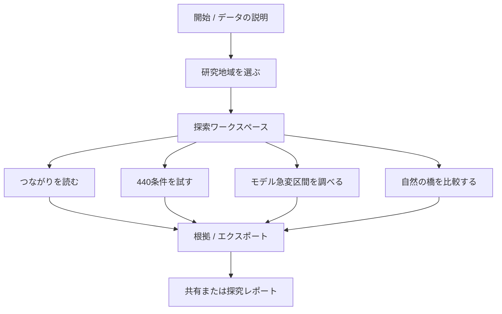

# 02｜情報設計・画面フロー

## 研究を読む体験から、研究を試す体験へ

新アプリの主要な操作は4つ。すべてを**1つの地図ワークスペース**から行い、モードを切り替えても地域・出典・選択した条件を保持する。



## ルート候補

- `/`：イントロ。何ができるかと、できないことを説明。実データ画像は権利確認後のみ。
- `/explore`：地図を中心にしたメインワークスペース。地域選択、4モード切り替え。
- `/study/:studyId`：事前計算済み研究パッケージの詳細。未知のIDはエラー表示。
- `/evidence`：データ出典、採用済み数式、検証の種類、研究限界。
- `/methods`：専門家向け説明と数式・検証手順・反例。
- `/about`：プロジェクトの目的、旧版との差、開発記録。

MVPでは `/explore` と `/evidence` を最優先し、その他は段階的に追加する。

## デスクトップ画面の情報領域

```text
┌─────────────────────────────────────────────────────────────┐
│ ECO MIRROR 3.0   地域：新宿周辺  [2021]       [出典] [保存] │
├──────────────┬──────────────────────────────────┬───────────┤
│              │                                  │           │
│ 4つのモード  │   土地被覆地図・ネットワーク       │ 条件詳細 │
│              │   ※ 未検証の移動経路は描かない   │           │
│ つながり     │                                  │ λ/除去率 │
│ 条件を試す   │                                  │ 4/8近傍  │
│ 急変区間     │                                  │ 説明     │
│ 自然の橋     │                                  │           │
├──────────────┴──────────────────────────────────┴───────────┤
│ [土地被覆分類/モデル仮定/未実証]  計算版  取得日/出典/警告   │
└─────────────────────────────────────────────────────────────┘
```

## モバイル画面の情報領域

```text
┌─────────────────────┐
│ 地域選択   [根拠]    │
├─────────────────────┤
│ 地図・表示領域      │
│                     │
│                     │
├─────────────────────┤
│ 4モード切替（横移動）│
├─────────────────────┤
│ 条件パネル           │
│ 結果 / 注意事項      │
│ 根拠 / 保存          │
└─────────────────────┘
```

地図を一切操作できなくても、表形式で同じ結果に到達可能にする。

## 画面遷移・状態管理で守る条件

- 地域を変更した瞬間、前地域の計算結果を「現在の結果」として表示しない。
- 出力の正本は研究実行ID＋データハッシュ＋条件ID。
- 処理が間に合わないとき、前回値の流用ではなく「読み込み中/失敗」を表示。
- 事前計算済みデータは出典が一致した場合のみ採用。
- モバイルでは条件パネルを折りたたみ可能にし、地図を隠さない。
- 根拠表示を有料会員登録やログインで制限しない。

## 用語の推奨表現

| 使う | 避ける |
|---|---|
| 植生候補、土地被覆 | ハナバチの生息地（未検証） |
| 構造的なつながり | 生き物の本当の移動経路 |
| 仮想条件、ストレス試験 | 440の未来予言 |
| モデル上の最大低下区間 | 生態系崩壊の限界点 |
| 仮想的な接続候補 | 実際に緑化すべき土地 |
