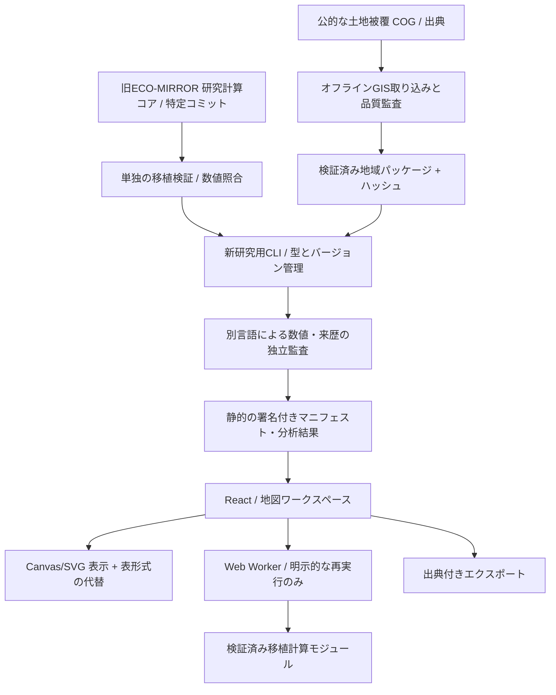

# 04｜技術アーキテクチャ v0.1

## 初期採用方針

静的に配信できる **React + TypeScript + Vite のPWAを志向したWebアプリ**。実装時に、依存パッケージの安定版・ライセンス・脆弱性を再確認してロックファイルに固定する。**第1工程でReact/Viteアプリの基本骨格を追加済み。研究エンジンの原本移植と静的データ配信は実装済み。正式な探索UIへの統合は未実施。**

- ランタイムに生成AI API・有料地図API・データベースサーバー・ログインを要求しない。
- 基本は**事前に監査済みの公開研究結果JSON**を静的配信。ブラウザは必要範囲のみ遅延取得。
- 新たな研究実行は実験的な機能としてWeb Workerで行い、メインスレッドで440×候補数を同期計算しない。
- データ検証と重い地理処理はビルド前のCLI実験環境で行う。2021 WorldCover COGの再投影にはPython/rasterioを採用した既存検証済みコードを移植する。
- Map SDKの採否は後で比較。MVPは自前の**オフライン向け格子レイヤー＋SVG/Canvas**で地図の基本表示を実装し、無償外部タイルの無断大量取得や有料API依存を避ける。

## 構成図



※ 「署名付きマニフェスト」は将来の改ざん対策の設計目標。MVP初期は SHA256 とCI再現検証を実装し、暗号署名の導入可否を別途判断する。SHA256 は真正性の証明とは限らない。

## 推奨ディレクトリ（アプリ実装開始後）

```text
src/
  app/                     # ルート、エラー境界、ナビゲーション
  design/                  # Tokensと共通コンポーネント
  features/studies/        # 地域一覧、マニフェスト検証、出典
  features/map/            # 2D地図、ラスタ描画、凡例
  features/landscape/      # 旧研究コードから監査後に移植する純粋コア
  features/scenarios/      # 440条件と設定UI
  features/thresholds/     # モデル低下区間と感度の説明
  features/bridges/        # 仮想介入・PC/連結判定を別表示
  features/evidence/       # 証拠・警告・出典・保存
  workers/                 # 重い計算と取消
  types/                   # 実行状態と結果契約
public/studies/            # 版固定の事前計算パッケージ
scripts/import/            # 公的COGの取得・変換（ブラウザ非依存）
scripts/validation/        # 独立監査・ベンチマーク
```

## 計算とデータの責務分離

| モジュール | 入力 | 出力 | 禁止 |
|---|---|---|---|
| Loader | マニフェスト・静的JSON | 検証済みの研究パッケージ | ハッシュ不一致を無視する |
| Calculation | 版固定の分類・パラメータ | 数値結果・モデル状態 | 動植物の事実を勝手に推定する |
| Visualization | 型検証済み結果 | 地図・表・説明文 | 合成の計算結果を現地実測に見せる |
| Export | 研究ID・結果・証拠 | 再現に必要なJSON | データ年・出典・警告を削除する |

## パフォーマンス計画

旧版研究の6地域実行は、1地域につき440条件＋16地点×440条件の仮想変更を**Linuxランナーで約13–19秒、最大RSS約321–358MiB**消費した。これをスマホのメインスレッドで走らせない。

- 研究対象6地域の結果を事前生成・圧縮し、全量を最初にダウンロードしない。
- 初回表示は地域マニフェストと縮約した分類・概要だけ。
- ユーザーがシナリオを選んだ時だけ条件単位の結果・曲線を読み込む。
- Web Workerで計算する場合は `runId` と `datasetId` を照合し、古い結果を新しい画面に表示しない。
- 描画：格子ごとのReact DOMは作らずCanvasまたはテクスチャ。選択・フォーカス・説明はDOM。
- キャッシュ：ハッシュをファイル名・マニフェストに含め、古い計算と新しいデータを混ぜない。

## プライバシー

- MVPにアカウント、個人の正確な位置情報、広告・追跡SDK、クラウド同期は不要。
- 地域選択は用意した研究地点から行う。ブラウザの位置情報権限は要求しない。
- エクスポートをユーザーの端末で完結させる。

## 公開前に決めるもの

ホスティング（無料静的配信の利用条件）、依存ライセンス、CSP、画像配信方法、PWAオフライン範囲、ブラウザ互換テスト対象。これらは**現段階で検証完了と呼ばない**。


## 実装済みのUI非依存境界（準備①〜⑤）

`src/research/index.ts`を後のUIから利用する。詳細は[文書19](19-pre-ui-foundation.md)。
リリース固定SHA付きloader→不変ResearchStudy→条件/曲線/候補比較、MapInput→module Worker→MapFrameに責務を分ける。
重い格子処理はWorkerで行い、取消時はterminateする。UIで440条件や全候補のPCを再計算しない。
`src/studies/verifiedStudyLoader.ts`は既存の低水準リーダーで、リリース全体の固定とファイル間整合性検証を加えた入口が`loadResearchStudy`。
既存データ検証パネルは既存の低水準リーダーの利用を継続しており、新APIを正式な探索UIへ統合するのは後続工程。
